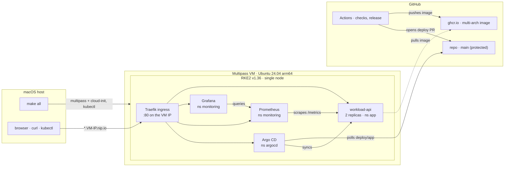

# rke2-gitops-observability

[](https://github.com/devjuank/rke2-gitops-observability/actions/workflows/checks.yml)

A local single-node **RKE2** cluster on a Multipass VM, running a small Go service observed with **Prometheus + Grafana**, delivered through **GitHub Actions + Argo CD**. Built as a take-home DevOps exercise.

Everything is code: the VM, the cluster add-ons, the app, its dashboard and the pipeline. One command builds it from zero and checks it.

## Architecture



| Layer | What | Where |
|---|---|---|
| VM | Multipass, Ubuntu 24.04 arm64, 4 vCPU / 8 GB / 40 GB, provisioned by cloud-init | [`infra/cloud-init.yaml`](infra/cloud-init.yaml) |
| Cluster | RKE2 v1.36.6 single node, with its bundled Traefik ingress | same |
| App | `workload-api`, a small Go service with a simulated workload | [`app/`](app/), [`deploy/app/`](deploy/app/) |
| Monitoring | kube-prometheus-stack (Prometheus, Grafana, Operator) + a dashboard as code | [`deploy/monitoring/`](deploy/monitoring/) |
| Delivery | Argo CD syncs `deploy/app` from `main`; GitHub Actions tests, builds and opens deploy PRs | [`deploy/argocd/`](deploy/argocd/), [`.github/workflows/`](.github/workflows/) |

GitHub never reaches the cluster: the cluster pulls from GitHub. The VM stays private on the laptop.

## Quick start

**Prerequisites** (tested on macOS, Apple Silicon, 16 GB RAM):

| Tool | Install |
|---|---|
| [Multipass](https://canonical.com/multipass) | `brew install --cask multipass` |
| kubectl 1.35+ | `brew install kubectl` (keep it within one minor version of the cluster) |
| make | Xcode Command Line Tools: `xcode-select --install` |

Go 1.27+ and Docker are only needed to develop the app; the image is public.

**Run:**

```sh
make all    # ~15–20 min from zero: VM + RKE2, monitoring + Argo CD + app, then the checks
```

`make all` is `make up` (VM and RKE2), `make deploy` (everything in the cluster; prints the URLs) and `make verify` (the checks below). Run `make help` for all targets. To use `kubectl` yourself: `export KUBECONFIG=$PWD/kubeconfig` (gitignored; your `~/.kube/config` is untouched).

**URLs** (`make urls` prints them with your VM's IP):

| Service | URL | Login |
|---|---|---|
| App | `http://app.<VM-IP>.nip.io/` (also `http://<VM-IP>/`) | |
| Grafana | `http://grafana.<VM-IP>.nip.io/` → Dashboards → **workload-api** | `admin` / `make grafana-password` |
| Prometheus | `http://prometheus.<VM-IP>.nip.io/` | |
| Argo CD | `http://argocd.<VM-IP>.nip.io/` | `admin` / `make argocd-password` |

[nip.io](https://nip.io) resolves `<name>.<VM-IP>.nip.io` to `<VM-IP>`, so there are no `/etc/hosts` edits. If it doesn't resolve on your network, see [Troubleshooting](#troubleshooting).

**Tear down:** `make down` deletes the VM and `./kubeconfig`.

## Verify

`make verify` ([`scripts/verify.sh`](scripts/verify.sh)) checks the acceptance criteria that can be automated and exits non-zero if any fails:

```
Cluster (AC-1)
  ✔ node Ready
  ✔ all pods Running or Completed
App (AC-2..AC-5)
  ✔ workload-api: 2/2 pods Ready
  ✔ readiness (/readyz) and liveness (/healthz) probes configured
  ✔ CPU/memory requests and limits set
  ✔ RollingUpdate maxSurge 1 / maxUnavailable 0
  ✔ http://app.<VM-IP>.nip.io/ → 200 (/, /healthz, /readyz)
Monitoring (AC-6, AC-7)
  ✔ Grafana reachable, admin login works
  ✔ Prometheus target workload-api UP (2/2)
  ✔ http_requests_total is queryable
  ✔ http_request_duration_seconds is queryable
Dashboard (AC-8)
  ✔ Grafana dashboard 'workload-api' loaded from its ConfigMap
GitOps (AC-10)
  ✔ Argo CD UI reachable
  ✔ Application workload-api Synced and Healthy
Access from this machine
  ✔ *.nip.io resolves
```

Things worth seeing by hand (`export KUBECONFIG=$PWD/kubeconfig` first):

```sh
# Dashboard with live data: generate traffic, then open the workload-api dashboard
make load                                              # Ctrl-C to stop

# Zero-downtime rollout: no request fails while pods are replaced
while true; do curl -s -o /dev/null -w '%{http_code}\n' http://<VM-IP>/; done | sort | uniq -c   # Ctrl-C after the rollout
kubectl -n app rollout restart deploy/workload-api     # in another terminal

# Readiness gating: a new pod is Running but not Ready for STARTUP_DELAY_SECONDS (5 s)
kubectl -n app get pods -w

# Self-heal: Argo CD reverts manual changes within seconds
kubectl -n app scale deploy workload-api --replicas=1
```

## How it works

### The app: `workload-api`

A small Go service ([`app/`](app/)) built so probes and metrics are easy to observe: `net/http`, `prometheus/client_golang`, `log/slog`, table-driven tests.

| Endpoint | Behavior |
|---|---|
| `/` | Always 200: JSON with the build version and the pod's hostname |
| `/work` | Simulated workload: random latency (10 ms to `WORK_MAX_LATENCY_MS`), fails with 500 at `WORK_ERROR_RATE` |
| `/healthz` | Liveness: 200 whenever the process serves HTTP; never checks dependencies |
| `/readyz` | Readiness: 503 during `STARTUP_DELAY_SECONDS` and after SIGTERM, 200 otherwise |
| `/metrics` | `http_requests_total{method,path,code}`, `http_request_duration_seconds{method,path}`, Go/process metrics |

Configured with env vars, set in the Deployment so they change through Git: `PORT` (8080), `WORK_MAX_LATENCY_MS` (500), `WORK_ERROR_RATE` (app default 0.05; the Deployment sets 0.10), `STARTUP_DELAY_SECONDS` (app default 0; the Deployment sets 5). On SIGTERM it marks itself not ready, keeps serving for 5 s while Kubernetes removes it from the endpoints, then drains in-flight requests (up to 10 s).

The image is multi-stage, `CGO_ENABLED=0`, on `gcr.io/distroless/static:nonroot` (~11 MB), published for `linux/arm64` and `linux/amd64` as `ghcr.io/devjuank/workload-api:sha-<commit>`.

```sh
make test                              # go vet + go test -race
STARTUP_DELAY_SECONDS=10 make run      # run locally on :8080
make load URL=http://localhost:8080    # local traffic
```

### Kubernetes manifests

[`deploy/app/`](deploy/app/) is plain YAML assembled with Kustomize; the image tag is pinned in `kustomization.yaml`.

- **Deployment:** 2 replicas; `RollingUpdate` with `maxSurge: 1`, `maxUnavailable: 0`, so a new pod must pass readiness before an old one goes.
- **Probes:** readiness on `/readyz` every 2 s, failing fast to take the pod out of the Service; liveness on `/healthz` every 10 s, 3 failures before a restart.
- **Resources:** requests `50m` / `64Mi`, limits `200m` / `128Mi`.
- **Security:** the namespace enforces Pod Security `restricted`; the container runs as UID 65532, read-only root filesystem, no privilege escalation, all capabilities dropped, no service account token.
- **Service + Ingress:** ClusterIP on port 80 and a Traefik Ingress with no `host`, so it works whatever the VM IP is.
- **ServiceMonitor:** tells Prometheus to scrape `/metrics` on every pod every 15 s.

### Monitoring and dashboard

kube-prometheus-stack is a `HelmChart` resource ([`deploy/monitoring/kube-prometheus-stack.yaml`](deploy/monitoring/kube-prometheus-stack.yaml)) that RKE2's built-in helm-controller installs; there's no `helm` CLI. Prometheus keeps 1 day of data without persistent storage and discovers ServiceMonitors in all namespaces. Grafana ships the chart's Kubernetes dashboards; its admin password is random, created by `make deploy` as a Secret. Alertmanager is off (alerting is out of scope).

The **workload-api** dashboard is [`deploy/monitoring/dashboards/workload-api.json`](deploy/monitoring/dashboards/workload-api.json), packed into a ConfigMap labeled `grafana_dashboard: "1"` that Grafana's sidecar loads by itself:

| Row | Panels |
|---|---|
| At a glance | Request rate · Error rate · p95 latency of `/work` · Ready pods |
| Traffic (RED) | Request rate by path · Error rate (% 5xx) |
| Latency and stability | `/work` latency p50 / p95 / p99 · Container restarts |
| Resources | CPU per pod vs request/limit · Memory per pod vs request/limit |

Probe traffic is excluded from the request and error panels. Histogram buckets match `/work`'s 10–500 ms range; with the client's defaults (0.5 s → 1 s), p99 read ~0.7 s for a workload that never exceeds 0.5 s. To change the dashboard, export it from Grafana, replace the JSON and run `make deploy`.

### GitOps with Argo CD

Argo CD ([`deploy/argocd/`](deploy/argocd/)) deploys `deploy/app` from the `main` branch with automated sync, so nobody runs `kubectl apply` on the app:

- **Git is the source of truth:** a commit to `deploy/app` reaches the cluster on its own (Argo CD polls every ~2–3 min; *Refresh* in the UI makes it immediate).
- **Self-heal** reverts manual changes; **prune** removes what was deleted from Git.

`make deploy` installs Traefik's settings, the monitoring stack, Argo CD and the Application, in that order. Monitoring and the dashboard are applied by `make deploy`, not by Argo CD.

> Forked this repo? Point `repoURL` in [`deploy/argocd/application.yaml`](deploy/argocd/application.yaml) at your fork, or Argo CD keeps deploying from this one.

### CI/CD

`main` is protected by a ruleset: every change goes through a pull request, the `checks` workflow must pass, squash merge only, no force-push, no bypass.

```
PR touching app/ ──merge──▶ release.yml: checks → build + push ghcr.io/…:sha-<commit>
                                        → opens "deploy: workload-api sha-<commit>" PR (auto-merge)
deploy PR ──checks pass──▶ auto-merged into main ──▶ Argo CD syncs ──▶ rolling update, zero downtime
```

- **[`checks.yml`](.github/workflows/checks.yml)** (every PR, `main`, and the first stage of a release; read-only): `gofmt` / `go vet` / `go test -race`; Kustomize output validated by [kubeconform](https://github.com/yannh/kubeconform) against Kubernetes 1.36 and CRD schemas; dashboard JSON; `shellcheck`; image build.
- **[`release.yml`](.github/workflows/release.yml)** (merges touching `app/`): builds and pushes the image with the built-in `GITHUB_TOKEN`, then opens a deploy PR that changes one line, `newTag` in `deploy/app/kustomization.yaml`. Every deployment is a PR, and rolling back is reverting it.
- **No loop:** the release only runs on `app/**`; the deploy PR only touches `deploy/app`.
- **Deploy PRs are opened by a GitHub App** (secrets `RELEASE_APP_ID`, `RELEASE_APP_PRIVATE_KEY`), because PRs opened with `GITHUB_TOKEN` don't trigger the required checks. It's only needed to run releases from a fork, not to run the project.

## Key decisions

Full reasoning, including what was discarded, is in [`docs/DECISIONS.md`](docs/DECISIONS.md).

| Decision | Why |
|---|---|
| **Multipass VM** on the Mac | RKE2 needs real Linux with systemd; one command, native virtualization, cloud-init support |
| **Makefile**, not Terraform | A disposable local VM gains nothing from Terraform state; `make` is the most universal entry point |
| **cloud-init**, not Ansible | Runs at first boot with no SSH or inventory; the same file works as EC2/Azure user data |
| **Traefik**, RKE2's default ingress | Upstream ingress-nginx was retired in March 2026; RKE2 v1.36 ships Traefik by default |
| **nip.io** hostnames, hostless app Ingress | No `/etc/hosts` edits and no IPs in Git, so it works on any machine |
| **Own Go service** with `/work` | Full control over RED metrics and probe semantics; a simulated workload makes the dashboard meaningful |
| **Kustomize**, not a Helm chart | Plain, readable YAML, built into kubectl and Argo CD |
| **kube-prometheus-stack** as an RKE2 `HelmChart` | Prometheus, Grafana, the Operator (ServiceMonitor) and cluster metrics in one declarative resource |
| **Dashboard as code** | Versioned, reproducible, loaded automatically |
| **Argo CD** (pull-based GitOps) | No cluster credentials in CI; drift is reverted; a laptop VM can't be reached by GitHub anyway |
| **Deploy PRs on a protected `main`** | Every deployment is reviewed by the same checks and auditable; rollback is a revert |
| **Rolling update** with readiness gating | Zero downtime without extra components; canary is a next step |

**Assumptions:** the reviewer has macOS or Linux with Multipass (the cloud-init works on any Ubuntu VM); the repository and the image are public, so nothing needs credentials to run; nip.io is reachable (or the `/etc/resolver` fix below applies); RKE2 and chart versions are pinned to the ones tested here.

## Production next steps

Out of scope for a local exercise, and what I'd do next:

- **Topology:** 3 control-plane nodes (etcd quorum) plus dedicated workers, provisioned with Terraform and bootstrapped with the same cloud-init; Ansible for OS day-2 operations (patching, hardening).
- **Upgrades:** RKE2 with Rancher's System Upgrade Controller (declarative, node by node, cordon/drain).
- **Progressive delivery:** Argo Rollouts canary (20% → 50% → 100%) with automated analysis against Prometheus (error rate, p95) and automatic rollback; blue-green where an instant switch is needed.
- **GitOps at scale:** a separate config repository with environment promotion through PRs; Argo CD managing the platform too (app of apps: monitoring, dashboards, Traefik settings).
- **Observability:** persistent storage and retention for Prometheus/Grafana (Longhorn or a CSI driver), long-term storage (Thanos / remote write), SLO-based alerting via Alertmanager, logs with Loki, scraping RKE2's control-plane components.
- **Security:** TLS with cert-manager, NetworkPolicies, SSO for Grafana and Argo CD, secrets via External Secrets / Sealed Secrets, images pinned by digest, signed (cosign) and scanned (Trivy), GitHub Actions pinned by commit SHA.
- **CI:** an end-to-end job that installs RKE2 on the runner and runs `make deploy && make verify`.

## Troubleshooting

**`*.nip.io` doesn't resolve** (`curl: (6) Could not resolve host`). Some routers drop public DNS answers that point to private IPs (DNS rebinding protection). `make deploy` detects it. One-time fix on macOS, which sends only `*.nip.io` lookups to Cloudflare's DNS and leaves everything else unchanged:

```sh
sudo mkdir -p /etc/resolver
echo "nameserver 1.1.1.1" | sudo tee /etc/resolver/nip.io
```

Test with `curl` or a browser (`dig` ignores `/etc/resolver`); undo with `sudo rm /etc/resolver/nip.io`. Until then, the app also answers on `http://<VM-IP>/`.

**Some `helm-install-*` pods show restarts.** Expected: those jobs retry until their CRDs are registered, then end in `Completed`.

**Publishing the image by hand** (maintainers): `docker login ghcr.io` with a PAT that has `write:packages`, then `make image`. New ghcr.io packages are private; make it public once in Package settings.

## Docs

- [`docs/SPEC.md`](docs/SPEC.md): requirements and acceptance criteria
- [`docs/PLAN.md`](docs/PLAN.md): architecture and step-by-step plan
- [`docs/DECISIONS.md`](docs/DECISIONS.md): every decision, with the alternatives discarded
